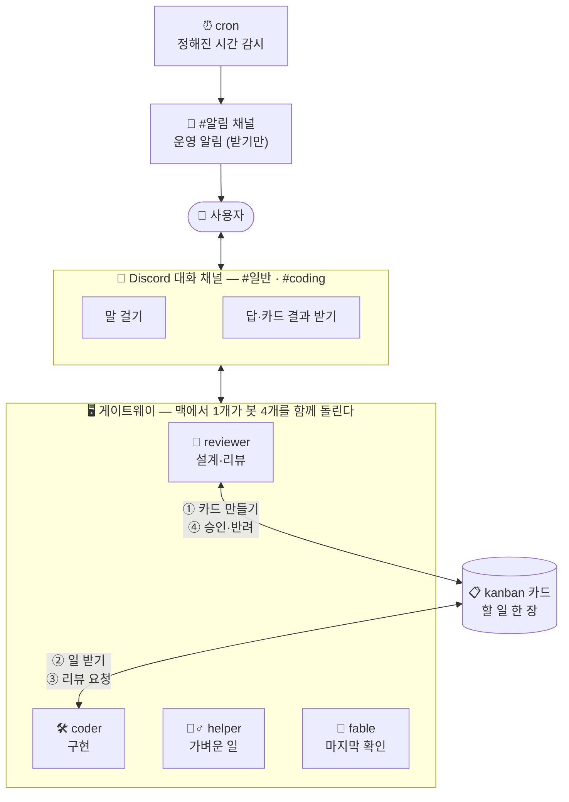
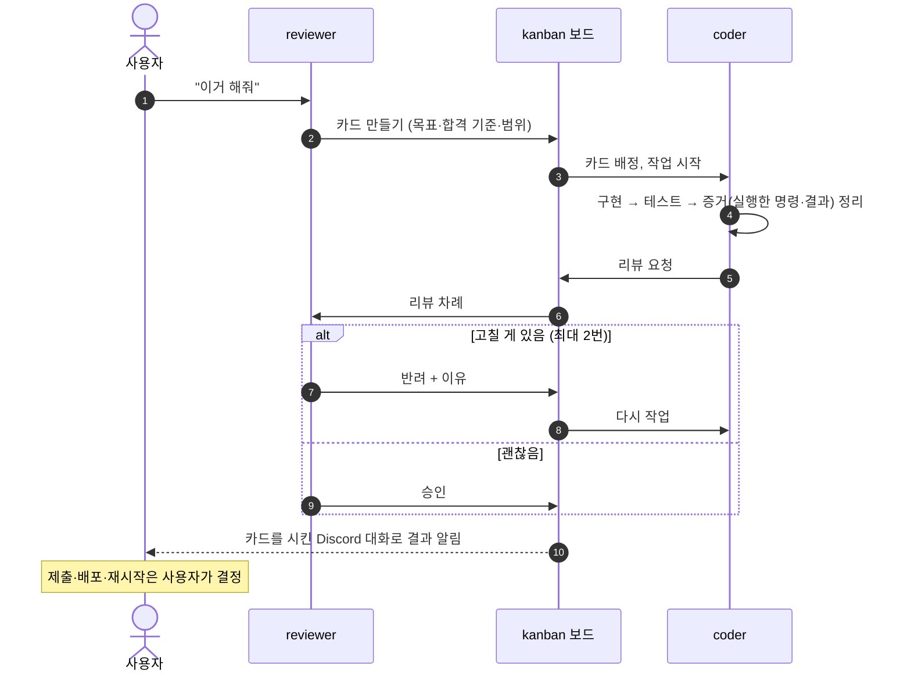

# 시스템 지도 — 한 장으로 보는 Hermes 봇 운영

> 처음 보는 사람용 요약이다. 자세한 설계는 `01_운영구조.md`, 지금 상태는 `00_현황.md`(로컬 전용)를 본다.
> 기준일 2026-11-28. 값은 각 프로필 `config.yaml`·cron 목록에서 읽었다.

## 1. 한 장 그림

**한 줄 요약**: 사용자가 Discord에서 말하면, 게이트웨이 하나가 봇 4개를 함께 돌린다. 큰 일은 reviewer가 **카드**로 쪼개 coder에게 맡기고, coder가 끝내면 reviewer가 리뷰한다. 감시·보고는 cron이 #알림으로 보낸다. 상태는 내 맥에서만 열리는 hub 대시보드로도 볼 수 있다. 최종 결정(제출·배포·재시작)은 항상 사용자가 한다.

## 2. 봇 4개 — 누가 무엇을 하나

| 봇 | 모델 | 하는 일 | 하지 않는 일 |
|---|---|---|---|
| 🧠 reviewer | claude-opus-5-5 (high) | 설계, 카드 만들기, 리뷰(승인·반려) | 코드를 직접 많이 쓰기 (안전장치가 감시) |
| 🛠️ coder | claude-sonnet-5-5 (high) | 카드 받아 구현·테스트, 증거 붙여 리뷰 요청 | 스스로 승인하기 |
| 🙋‍♂️ helper | claude-sonnet-5-5 (medium) | 가벼운 질문·정리 | 큰 구현 |
| 🔎 fable | claude-fable-5-1 (high) | 마지막 확인만 | 결정하기 |

## 3. 카드 한 장이 흘러가는 길

막히면(기대값과 실측이 다르거나 결정이 필요하면) coder는 **멈추고 묻는다**(blocked). 혼자 기준을 바꾸지 않는다.

## 4. 안전장치 — 봇이 실수하지 않게 붙인 것

| 장치 | 붙은 봇 | 막는 실수 | 지금 상태 |
|---|---|---|---|
| role-guard | reviewer | 리뷰어가 코드를 직접 많이 쓰는 것 | 경고만(warn) |
| evidence-gate | coder | 실행 안 한 명령을 "했다"고 적는 것 | 경고만(warn) |
| skill-label-guard | 전부 | 쓰지 않은 스킬을 썼다고 적는 것 | 고쳐서 내보냄 |
| skill-ledger | coder | (막지 않음) 스킬 사용 기록만 | 기록 중 |
| discord-cards | helper | (시험) 버튼 카드 | 시험 중 |

"경고만"은 막지 않고 기록만 남긴다는 뜻이다. 오탐이 충분히 적은 것이 확인되면 사용자가 "막기(enforce)"로 바꿀지 정한다(`04_운영지표.md` §3.3).

## 5. 알림이 오는 곳

| 어디 | 무엇 |
|---|---|
| #알림 | cron 감시 결과(자원·세션 비대·정정률 주간 지표·kanban 이상), 비용 보고 |
| #일반·#coding | 봇과 하는 대화 + 그 대화에서 시킨 카드의 끝남·막힘 알림 |
| #kanban-feed | 모든 카드 소식을 한곳에 모으는 채널 (**준비 중**, 결정 D29 · 구현 카드 N1) |

## 6. 어디를 보면 되나

| 알고 싶은 것 | 문서 |
|---|---|
| 전체 구조 자세히 | `01_운영구조.md` |
| 프로젝트와 보드 연결 | `02_프로젝트_연결.md` |
| 문제 생겼을 때 할 일 | `03_runbook.md` |
| 숫자로 보는 상태(오탐률·정정률) | `04_운영지표.md` |
| 왜 이렇게 정했나 | `05_결정기록.md` |
| 안전장치 설계 | `09_강제장치_설계.md` |
