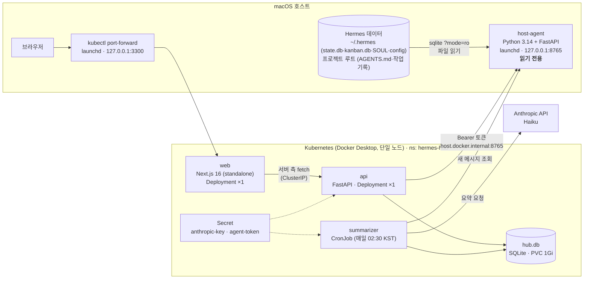
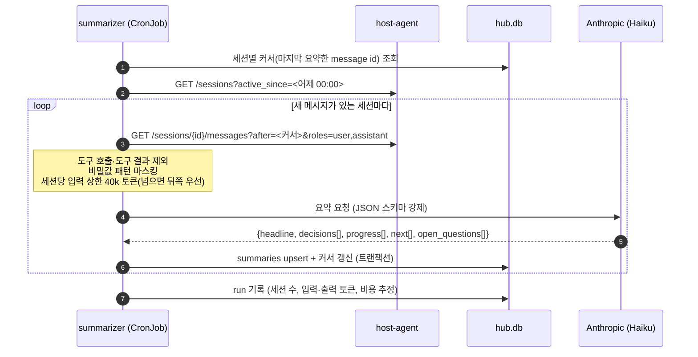

# 08. 통합 대시보드 (Hermes Ops Hub) 설계서

작성 2026-10-12 · 상태: **설계 확정, Phase 0 진행 중 (10-14)** · 대상 환경: macOS 1대 (Apple Silicon), Docker Desktop, 단일 노드 Kubernetes

> Hermes 기본 대시보드는 봇을 **관리**하는 화면이다. 이 설계는 그 옆에 **프로젝트 중심으로 정리해서 보는** 화면을 따로 만든다:
> 프로젝트별 상태·적용 규칙·스레드 요약·봇 상태를 한곳에서 읽는다. Hermes 자체는 고치지 않고, Hermes 데이터는 **읽기만** 한다.

---

## 0. 핵심 결정 요약

| # | 결정 | 이유 |
|---|---|---|
| K1 | 프론트 **Next.js 16 (App Router) + React 19**, 백엔드 **Python 3.14 + FastAPI** | 사용자 지정. 각 계열의 현재 안정 최신 (§10 버전표) |
| K2 | 앱은 **Docker 이미지**, 배포·관리는 **Kubernetes (단일 노드, Docker Desktop 내장)** | 사용자 지정. 서비스 3개 + 배치 1개를 한 선언(kustomize)으로 관리 |
| K3 | **Hermes 데이터는 컨테이너에 직접 마운트하지 않는다.** 맥 호스트에서 도는 작은 `host-agent`가 읽어 HTTP로 넘긴다 | Hermes DB는 SQLite **WAL 모드**(실측). WAL은 공유 메모리(`-shm`)로 읽기·쓰기를 조율하는데, 맥 호스트와 Docker Desktop의 리눅스 VM 사이 파일 공유에서는 이 공유 메모리가 일치하지 않는다. 컨테이너에서 라이브 DB를 열면 손상·오독 위험 |
| K4 | 요약은 **배치(CronJob, 하루 1회)**, 모델 **Haiku**, 결과는 허브 자체 DB에 저장 | 토큰 최소. 게이트웨이(봇) 프로세스와 완전히 분리해 06_이슈 #17(게이트웨이 지연)을 악화시키지 않는다 |
| K5 | 외부 노출 없음. 접속은 **127.0.0.1 전용** | 화면에 프로젝트 원문·대화 요약이 보인다 |
| K6 | 허브 DB는 **SQLite (PVC, 단일 노드)** | 사용자 1명, 쓰기 주체 1개(요약 배치). Postgres는 운영 부담 대비 이득 없음. 다중 노드로 갈 때 교체 (§13) |

---

## 1. 목표와 범위

### 목표
1. **프로젝트 카드**: 프로젝트(작업 폴더)마다 한 줄 상태, 마감, 진행 중 태스크, 최근 결정, 다음 할 일.
2. **규칙 지도**: 폴더마다 실제로 적용되는 규칙 순서(공통 → 프로젝트 `AGENTS.md`, 자체 `.git` 때문에 공통이 빠지는 경우 경고), 각 파일의 수정일·크기(8k자 초과 경고), 봇 4개 SOUL의 역할·금지사항 요약.
3. **스레드 요약**: Discord 스레드(=세션)별 날짜 요약 — 결정, 진행, 다음 할 일, 원문 세션 ID 링크.
4. **봇 상태**: 모델·effort, Discord 연결, 인증 상태, 최근 끊김.
5. **운영 알림**: 옛 SOUL로 도는 열린 스레드, 꺼진 채 쌓인 cron, 연결 끊김 원인 분류(네트워크 vs 게이트웨이 지연, 06_이슈 #17·#18).

### 비목표 (하지 않는 것)
- 봇에게 지시하기, 태스크 만들기, 설정 바꾸기 → 기존 Hermes 대시보드·Discord 사용.
- Hermes 파일·DB **쓰기** (한 바이트도 안 씀).
- 원격 접속, 여러 사용자, 공개 배포.

---

## 2. 현재 환경 (2026-10-12 실측)

| 항목 | 값 | 설계 영향 |
|---|---|---|
| Docker | Docker Desktop, Engine **29.7.2**, VM에 CPU 10 · 메모리 약 23 GiB | 자원 충분. 허브 전체 요청량 < 1 CPU, < 1.5 GiB로 잡는다 |
| kubectl | **v1.36.1** | 클러스터는 1.35~1.37 범위면 호환 |
| Kubernetes 컨텍스트 | **없음** (설정된 클러스터 0개) | Phase 0에서 Docker Desktop의 Kubernetes를 켜야 한다(사용자 GUI 작업) |
| Node (호스트) | v26.7.0 | 빌드는 컨테이너 안에서 하므로 무관 |
| Hermes DB | 세션 DB·kanban DB 모두 `journal_mode=wal` | K3의 근거 |

---

## 3. 아키텍처



### 구성요소 책임

| 구성요소 | 실행 위치 | 하는 일 | 하지 않는 일 |
|---|---|---|---|
| **host-agent** | 맥 호스트 (launchd) | Hermes·프로젝트 파일을 네이티브로 읽어 정규화된 JSON 제공. 비밀값 마스킹 | 쓰기, 요약, 무거운 집계 (요청당 50 ms 목표) |
| **api** | k8s | host-agent 응답 + 허브 DB(요약·알림)를 합쳐 화면용 API 제공. 짧은 캐시(30 s) | Hermes 직접 접근 |
| **web** | k8s | 화면. 데이터는 서버 컴포넌트에서 api 호출 (브라우저는 api를 직접 모름) | 비즈니스 로직 |
| **summarizer** | k8s CronJob | 어제 이후 새 메시지가 있는 세션만 골라 Haiku로 요약 → 허브 DB | 실시간 요약, 봇 대화 개입 |

**왜 host-agent가 필요한가 (K3 상세)**: SQLite WAL 모드에서 읽는 쪽도 `-shm` 파일을 메모리 매핑해 쓰는 쪽과 위치를 맞춘다. Docker Desktop의 바인드 마운트(virtiofs)는 호스트 프로세스와 VM 안 프로세스 사이에 이 공유 메모리를 일치시켜 주지 않는다. 그래서 "읽기 전용 마운트"로도 안전하지 않다. 호스트에서 같은 커널로 읽는 프로세스 하나를 두면 이 문제가 사라지고, 봇 게이트웨이와도 프로세스가 분리된다.

---

## 4. 데이터 흐름

### 4.1 화면 조회 (토큰 0)
1. 브라우저 → `127.0.0.1:3300` → port-forward → `web`
2. `web` 서버 컴포넌트 → `api` (`/v1/...`)
3. `api` → 캐시 확인(30 s) → 없으면 `host-agent` 호출 + 허브 DB 조회 → 합쳐서 반환

### 4.2 요약 배치 (매일 02:30 KST)


- **멱등**: 커서 기준이라 같은 날 두 번 돌아도 중복 없음. 실패한 세션은 커서를 안 옮겨 다음 날 재시도.
- **비용 상한**: 1회 실행 입력 토큰 합계 상한(기본 400k). 넘으면 남은 세션은 다음 날로 미루고 알림.
- **도구 결과 제외**: 대화 품질 요약에 필요 없고, 파일 원문·로그가 대부분이라 토큰과 노출을 같이 줄인다.

---

## 5. 화면 구성

| 경로 | 화면 | 내용 |
|---|---|---|
| `/` | 홈 | 프로젝트 카드 그리드 · 봇 4개 상태 줄 · 운영 알림 배지 |
| `/projects/[slug]` | 프로젝트 | 상태 한 줄·마감 / 진행 중 태스크(보드 읽기) / 최근 결정(작업 기록 문서의 `사용자 결정(override)`·결정 절) / **스레드 요약 타임라인** / 적용 규칙 순서 |
| `/rules` | 규칙 지도 | 폴더 트리 × 적용 체인 표. 각 파일 수정일·크기·8k 경고·`../AGENTS.md` 참조 여부. 클릭 시 원문(읽기 전용, 마크다운 렌더) |
| `/bots` | 봇 | 역할 한 줄, 모델·effort, Discord 연결·마지막 끊김·원인 분류, 인증 상태, 핵심 금지사항(SOUL에서 추출) |
| `/threads/[sessionId]` | 스레드 | 날짜별 요약 카드, 원문 세션 ID, 메시지 수, 참여 봇 |
| `/ops` | 운영 | 옛 규칙으로 도는 열린 스레드, cron 목록(켜짐/꺼짐/마지막 실행), 최근 7일 끊김 그래프, 요약 배치 실행 기록·비용 |

UI 원칙: 읽기 전용, 서버 렌더링 우선(빠른 첫 화면), 다크/라이트, 모바일 폭 고려는 하지 않음(맥 전용).

---

## 6. API 명세

### 6.1 host-agent (호스트, `127.0.0.1:8765`, Bearer 토큰 필수)

| 메서드·경로 | 반환 | 출처 |
|---|---|---|
| `GET /health` | `{ok, hermes_version, read_at}` | — |
| `GET /projects` | `[{slug, path, has_git, agents_chain:[{path, bytes, mtime, refs_parent}], board, deadline?}]` | 프로젝트 루트 스캔, `AGENTS.md` 헤더 파싱 |
| `GET /projects/{slug}/files/{relpath}` | 원문 텍스트 (허용 목록: `AGENTS.md`, `docs/*.md`) | 파일 |
| `GET /bots` | `[{profile, model, effort, discord:{state, error_code, updated_at}, auth:{ok, source}}]` | 프로필 `config.yaml`, `gateway_state.json`, 자격증명 **존재 여부만** |
| `GET /bots/{profile}/soul` | SOUL 원문 (ID는 `<USER_ID>`로 마스킹) | `SOUL.md` |
| `GET /sessions?active_since=` | `[{id, profile, source, title, thread_id, message_count, last_activity_at, stale_rules:bool}]` | 세션 DB (ro) |
| `GET /sessions/{id}/messages?after=&roles=` | `[{id, role, ts, text}]` (최대 2,000건, 비밀값 마스킹) | 세션 DB (ro) |
| `GET /boards` / `GET /boards/{slug}/tasks?status=` | 보드·태스크 요약 | kanban DB (ro) |
| `GET /cron` | 프로필별 cron `{id, name, enabled, last_run}` | `cron/jobs.json` |
| `GET /incidents?days=7` | 끊김 이벤트 `{ts, profile, kind: network|gateway_lag|auth}` | 로그 파일 꼬리 읽기 (최근 N MB만) |

- 모든 SQLite 연결: `file:<path>?mode=ro` + `PRAGMA query_only=1`, 요청마다 열고 닫기(장기 연결 없음 → 체크포인트 방해 안 함).
- `stale_rules`: 세션의 저장 프롬프트 해시 ≠ 현재 SOUL로 만든 프롬프트 해시 (03_runbook·스킬에 있는 방식).

### 6.2 api (k8s 내부, web만 호출)
`/v1/overview`, `/v1/projects`, `/v1/projects/{slug}`, `/v1/rules`, `/v1/bots`, `/v1/threads/{id}`, `/v1/ops` — 화면 단위로 묶은 응답. 스키마는 Pydantic 모델 → OpenAPI → **web에서 타입 자동 생성**(`openapi-typescript`), 응답 검증은 zod.

---

## 7. 허브 DB 스키마 (SQLite, WAL, PVC)

| 테이블 | 주요 열 | 비고 |
|---|---|---|
| `summaries` | `session_id, day, profile, project_slug, headline, decisions_json, progress_json, next_json, open_q_json, msg_from, msg_to, model, in_tokens, out_tokens, created_at` | PK `(session_id, day)` |
| `cursors` | `session_id, last_message_id, updated_at` | 요약 커서 |
| `runs` | `id, started_at, ended_at, sessions, in_tokens, out_tokens, est_cost_usd, status, error` | 배치 기록 |
| `alerts` | `id, kind, ref, message, first_seen, last_seen, acked` | 운영 알림 (api가 생성·갱신) |

마이그레이션: Alembic 대신 버전 번호 + SQL 파일(테이블 4개라 충분).

---

## 8. 요약 프롬프트 설계

- 모델: `claude-haiku-4-5` (기존 helper-bot과 같은 계열, 저비용).
- 출력: **JSON 스키마 강제**(tool use 방식). 필드: `headline`(한 줄), `decisions[]`(누가·무엇을·근거 한 줄), `progress[]`, `next[]`, `open_questions[]`. 각 항목 ≤ 120자, 한국어.
- 규칙(시스템 프롬프트 요지):
  - 대화에 **있는 것만** 쓴다. 추측·평가 금지. 수치는 원문 그대로.
  - 사용자 발화의 결정·지시는 `decisions`에 원문 인용(따옴표)으로.
  - 봇의 "~할게요"는 `next`, 완료 보고는 `progress`.
  - 비밀값처럼 보이는 문자열은 이미 마스킹돼 있으며 복원하지 않는다.
- 검증: 출력 JSON 파싱 실패 시 1회 재시도, 그래도 실패면 해당 세션 건너뛰고 `runs.error`에 기록.
- 품질 점검(Phase 2 완료 기준): 임의 세션 10개를 사람이 원문과 대조 — 사실 오류 0, 누락된 사용자 결정 ≤ 1.

---

## 9. Kubernetes 구성

### 9.1 저장소 구조 (새 저장소 `hermes-hub`, 비공개 권장)

```
hermes-hub/
├── apps/
│   ├── web/                 # Next.js 16 (output: 'standalone')
│   ├── api/                 # FastAPI (uv 관리)
│   └── summarizer/          # Python 배치 (api 패키지의 공용 모듈 재사용)
├── host-agent/              # 호스트용 FastAPI + launchd plist 템플릿
├── packages/schema/         # OpenAPI → TS 타입 생성물
├── deploy/
│   ├── base/                # kustomize: ns, deploy, svc, cronjob, pvc, configmap
│   └── overlays/local/      # 이미지 태그, 리소스, 시크릿 생성기(파일은 git 제외)
├── Makefile                 # build / load / deploy / logs / port-forward
└── docs/
```

### 9.2 리소스

| 오브젝트 | 설정 |
|---|---|
| Namespace | `hermes-hub` |
| `web` Deployment | replicas 1 · requests 100m/256Mi · limits 500m/512Mi · readiness `/api/health` · 비루트(uid 10001) · readOnlyRootFilesystem(+ `/tmp`, `.next/cache` emptyDir) |
| `api` Deployment | replicas 1 · 100m/192Mi · 500m/384Mi · readiness `/healthz` · PVC 마운트 `/data` · 비루트 · readOnlyRootFilesystem |
| `summarizer` CronJob | `30 17 * * *` (UTC = 02:30 KST) · `concurrencyPolicy: Forbid` · `activeDeadlineSeconds: 1800` · `backoffLimit: 1` · 성공 3·실패 3개 이력 보관 |
| PVC `hub-data` | 1Gi, RWO, 기본 StorageClass (`hostpath`) |
| Service | `web`·`api` 모두 **ClusterIP** (NodePort·LoadBalancer 쓰지 않음) |
| Secret | `anthropic-key`(요약 전용 키), `agent-token`(host-agent 인증) — `secretGenerator`로 **git 밖 파일**에서 생성 |
| ConfigMap | `HOST_AGENT_URL=http://host.docker.internal:8765`, 비용 상한, 요약 시간 등 |
| NetworkPolicy | 기본 거부 + web→api, api/summarizer→외부(host-agent, Anthropic)만 허용. ⚠ Docker Desktop 기본 CNI가 정책을 강제하지 않을 수 있음 → Phase 0에서 확인, 안 되면 문서화된 한계로 둔다 |

`api`와 `summarizer`가 같은 PVC를 쓴다. 단일 노드라 RWO로 두 파드가 같은 볼륨을 마운트할 수 있고, 같은 리눅스 커널 안이라 SQLite WAL 공유 메모리 문제가 없다(K3과 대비).

### 9.3 이미지

| 이미지 | 베이스 | 빌드 |
|---|---|---|
| `hub-web` | `node:24-slim` (빌드 단계 `node:24`) | `next build` standalone → 최종 이미지에 `.next/standalone` + `static`만. 목표 < 200 MB |
| `hub-api` / `hub-summarizer` | `python:3.14-slim` | `uv sync --frozen --no-dev` 다단계, 바이트코드 컴파일. 목표 < 150 MB |

- 태그는 git 짧은 해시. `latest` 금지.
- 레지스트리 없음: Docker Desktop 쿠버네티스가 로컬 이미지를 쓰는 방식(provisioning 방식에 따라 `imagePullPolicy: IfNotPresent` 또는 노드로 이미지 로드)을 **Phase 0에서 확인**해 Makefile `load` 단계에 반영.

### 9.4 접속
- `kubectl -n hermes-hub port-forward --address 127.0.0.1 svc/web 3300:3000` 을 launchd로 상시 실행(끊기면 재시작).
- 브라우저: `http://127.0.0.1:3300`. Hermes 데스크톱 미리보기 창에도 띄울 수 있다.

---

## 10. 버전 (2026-10-12 레지스트리·지원주기 조회 기준)

| 구성 | 선택 | 조회된 최신 | 선택 이유 |
|---|---|---|---|
| Next.js | **16.4.x** | 16.4.0 | 최신 안정. App Router·서버 컴포넌트·standalone 출력 |
| React | **19.3.x** | 19.3.0 | Next 16 짝 |
| TypeScript | **7.0.x** (대안 5.x) | 7.0.2 | 네이티브 컴파일러로 타입 검사가 빠름. ⚠ Next 16.4 빌드·린트 도구와의 호환을 **Phase 0에서 확인**, 문제 있으면 5.x로 고정 |
| Tailwind CSS | **4.3.x** | 4.3.3 | CSS 우선 설정, 빌드 빠름 |
| TanStack Query | 5.104.x | 5.104.2 | 클라이언트 측 새로고침(봇 상태 30 s 폴링)에만 사용 |
| zod | 4.6.x | 4.6.7 | api 응답 검증 |
| Node (컨테이너) | **24 LTS** | 26.11 (Current), 24.21 (LTS) | 26은 10-28에 LTS 전환 예정 → 그 전까지 24 LTS, 전환 후 26으로 올리는 작업을 Phase 4에 둠 |
| Python | **3.14.x** | 3.15.0 (갓 출시), 3.14.8 | 3.15는 막 나와 바이너리 휠 공급이 덜 됨. 3.14가 안정·지원(2030-10)·성능 균형 |
| FastAPI | 0.143.x | 0.143.0 | — |
| uvicorn | 0.54.x | 0.54.0 | — |
| Pydantic | 2.14.x | 2.14.1 | — |
| anthropic (Python SDK) | 1.13.x | 1.13.0 | 요약 배치 |
| httpx | 0.28.x | 0.28.1 | host-agent 호출 |
| Kubernetes (클러스터) | Docker Desktop 제공 버전 (1.35~1.37) | 1.37.1 | kubectl 1.36과 ±1 호환. 지원 종료가 가까운 1.34(2026-10-27 EOL)면 Docker Desktop 업데이트 |
| 패키지 관리 | pnpm (web), uv (Python) | — | 재현 가능한 잠금 파일, 빠른 설치 |

잠금 파일(`pnpm-lock.yaml`, `uv.lock`)을 커밋하고, 버전은 **마이너까지 고정**(패치는 자동 허용).

---

## 11. 보안

| 위협 | 대책 |
|---|---|
| 프로젝트 원문·대화 요약 노출 | 접속 127.0.0.1만. Service는 ClusterIP. host-agent도 127.0.0.1 바인드 |
| 다른 로컬 프로세스가 host-agent 호출 | Bearer 토큰(32바이트 랜덤, 파일 권한 600, k8s Secret) |
| 비밀값이 화면·요약에 섞임 | host-agent가 응답 전에 마스킹: `sk-ant-…`, Discord 봇 토큰 형태, `ghp_…`, AWS 키, PEM 헤더, 17~20자리 Discord ID. 요약 프롬프트에도 복원 금지 |
| 자격증명 파일 읽기 | host-agent는 `auth.json`·`.env`·`~/.claude`를 **열지 않는다**. 인증 상태는 `hermes auth list` 결과의 존재 여부만 사용 |
| 요약 비용 폭주 | 실행당 토큰 상한, 콘솔의 월 한도, **요약 전용 API 키**(다른 작업 키와 분리) |
| 허브가 Hermes를 망가뜨림 | 쓰기 경로 없음(ro URI + `query_only`), 장기 연결 없음, 로그는 꼬리만 |
| 이미지 공급망 | 공식 베이스 이미지, 잠금 파일, 비루트, 읽기 전용 루트 FS |

---

## 12. 운영

| 작업 | 방법 |
|---|---|
| 배포 | `make build load deploy` (이미지 빌드 → 클러스터에 적재 → `kubectl apply -k deploy/overlays/local`) |
| 상태 | `kubectl -n hermes-hub get pods,cronjobs`, 화면 `/ops` |
| 요약 수동 실행 | `kubectl -n hermes-hub create job --from=cronjob/summarizer summarize-now` |
| 백업 | `hub.db`를 매일 호스트 `~/.hermes-backups/`로 복사(기존 daily_backup에 한 줄 추가). 요약은 재생성 가능하지만 비용이 드므로 보관 |
| 로그 | `kubectl logs`, host-agent는 `~/Library/Logs/hermes-hub-agent.log` (회전 5 MB × 3) |
| 비용 확인 | `/ops`의 runs 표(추정) + Anthropic 콘솔(실제) |
| 중지 | `kubectl scale deploy --all --replicas=0 -n hermes-hub`, CronJob `suspend: true`, launchd 2개 unload |

예상 자원: 상시 약 0.2 CPU · 600 MiB (web+api+host-agent). 요약 배치 1회 수 분.
예상 비용: 활성 스레드 하루 5~10개 × 세션당 입력 10~40k 토큰 → Haiku 기준 하루 수 센트~수십 센트 (정확한 값은 Phase 2 첫 실행으로 측정해 이 절에 기록).

---

## 13. 단계별 계획

| 단계 | 내용 | 완료 기준 (숫자로) | 사용자 작업 |
|---|---|---|---|
| **Phase 0 · 환경 검증** (반나절) | Docker Desktop Kubernetes 켜기, 빈 nginx 파드로 ① 로컬 이미지 사용 방식 ② `host.docker.internal` → 호스트 127.0.0.1 서비스 도달 ③ NetworkPolicy 강제 여부 ④ TS 7 + Next 16.4 `next build` 통과 확인 | ①~④ 결과 표 기록, 막히는 항목은 대안 결정 | Docker Desktop 설정에서 Kubernetes 활성화 |
| **Phase 1 · 읽기 전용 화면** (1~2일) | host-agent + api + web, 화면 `/`, `/projects/[slug]`, `/rules`, `/bots` | 프로젝트·봇 수가 실제와 일치, 규칙 체인이 Hermes 로더(`_agents_md_candidates`) 결과와 폴더별 100% 일치, 첫 화면 < 1 s, 토큰 0 | 화면 확인·의견 |
| **Phase 2 · 스레드 요약** (1일) | summarizer CronJob, `/threads`, 프로젝트 타임라인 | 임의 10개 세션 대조: 사실 오류 0, 누락 결정 ≤ 1. 1회 비용 기록 | 요약 전용 API 키 등록(파일 → Secret) |
| **Phase 3 · 운영 화면** (1일) | `/ops`: 옛 규칙 스레드, cron 목록, 끊김 분류·그래프 | 06_이슈 #16~#18 사례를 과거 로그로 재생해 분류 정확 | — |
| **Phase 4 · 다듬기** | Node 26 LTS 전환(10-28 이후), 이미지 크기·보안 점검, 백업 연결, 문서 | 이미지 목표 크기 달성, 비루트·RO FS 확인 | — |

각 단계는 coder-bot 태스크로 구현하고 reviewer-bot이 위 완료 기준으로 리뷰한다(기존 파이프라인). 단계 사이에 사용자 확인.

---

## 14. 리스크와 미결정

| # | 항목 | 영향 | 대응 |
|---|---|---|---|
| R1 | Docker Desktop 쿠버네티스의 로컬 이미지 사용 방식 | 배포 단계가 달라짐 | Phase 0 ① |
| R2 | 컨테이너 → 호스트 127.0.0.1 도달 | 안 되면 host-agent를 Docker 브리지용 주소에 바인드해야 함(노출 범위 증가) | Phase 0 ②. 안 되면 host-agent를 `docker0` 쪽 주소 + 토큰 + 방화벽으로 제한 |
| R3 | TypeScript 7 호환 | 빌드 실패 | Phase 0 ④, 실패 시 5.x 고정 |
| R4 | NetworkPolicy 미강제 | 방어 한 겹 감소 | 127.0.0.1·토큰으로 1차 방어는 유지. 한계로 문서화 |
| R5 | 단일 노드 SQLite | 다중 노드 불가 | 현재 범위 밖. 필요해지면 Postgres로 교체(테이블 4개) |
| R6 | 쿠버네티스 자체의 상시 자원(컨트롤 플레인 약 1~2 GiB) | 맥 부하 증가 → 06_이슈 #17과 겹칠 수 있음 | Phase 1 후 게이트웨이 지연 경고 수를 전후 비교. 늘면 쿠버네티스 대신 `docker compose`로 낮추는 안을 재검토 |
| D1 | 저장소 공개 여부 | — | **결정 (10-14): 비공개** `hermes-hub` |
| D2 | 요약 범위 | 비용·노출 | **결정 (10-14): Discord 세션만**, 도구 결과 제외. kanban 워커 세션은 제외(필요해지면 재검토) |

---

## 15. 다른 방식과 비교 (기록용)

| 방식 | 장점 | 단점 | 판단 |
|---|---|---|---|
| Hermes 대시보드 플러그인(탭 추가) | 가장 가벼움, 인증·테마 공유 | 대시보드 프로세스 안에서 돎(무거운 일 금지), React SDK 제약, 화면 구성 자유도 낮음 | 관리 도구 느낌이 남는다는 사용자 의견으로 보류 |
| docker compose | 쿠버네티스보다 가볍고 단순 | 배치·재시작·선언적 관리가 약함 | R6 발생 시 대안 |
| **Kubernetes + Docker (이 설계)** | 선언적 관리, CronJob·프로브·리소스 제한 기본 제공, 다른 서비스 추가 쉬움 | 컨트롤 플레인 상시 자원, 학습·운영 비용 | **사용자 선택** |
